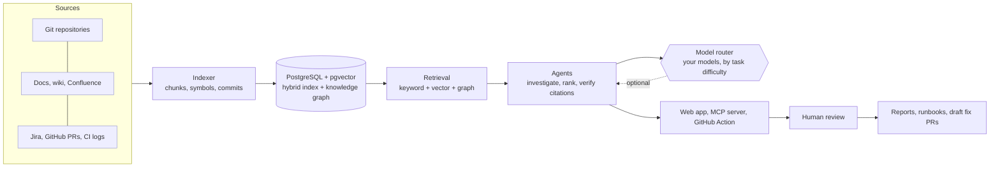

# RepoLens AI

**Version v0.1-beta.** Usable and tested, but early: expect rough edges and changes between releases. Releases are listed in the [changelog](changelog/README.md). The running version is shown in the app's sidebar and on the sign-in page, and returned by `/healthz`.

Repository intelligence and evidence-backed root-cause analysis. See [`docs/architecture.md`](docs/architecture.md) for how it
works and [`docs/features.md`](docs/features.md) for what is implemented.

**Stack:** FastAPI · LangGraph · PostgreSQL + pgvector · Tree-sitter · Vite + React + TypeScript + Tailwind ·
OpenTelemetry/Prometheus · Docker · Kubernetes · GitHub Actions.

**What it does:** turns your docs, pull requests, tickets and code into one searchable, connected knowledge base, and answers
from it with citations while keeping model cost low: several models are routed by task difficulty, repeated questions are
answered from a local memory, and retrieved context is condensed before it reaches a model. Nothing needs a model to work;
connecting one only improves the wording.

**Screens:** Dashboard (with a getting-started checklist and Ctrl+K jump-to), **DeepMind Wiki** (browse, ask, concepts, health, drift, proposals, sources), **Ownership**, Investigations (from a bug report or a CI log), **Knowledge** (Ask with citations, interactive graph, document upload), Repository Explorer,
Investigation View (root cause, confidence, timeline, code/commit/doc/test/PR evidence, report, human review), **Change
Risk** (score a commit, branch or PR with signals, blast radius and tests to run), Token Usage & Cost, Jira, Settings (LLM
provider + key, GitHub sign-in).

**Knowledge base:** ingests source code, Markdown/RST/text docs (git or upload), commits + diffs and GitHub pull
requests into one hybrid index and a typed knowledge graph (calls, imports, tests, doc links/mentions, semantic
similarity, PR↔commit↔file). See [`docs/architecture.md`](docs/architecture.md), the feature checklist in [`docs/features.md`](docs/features.md) and the
benchmark in [`evals/`](evals/README.md).

## How it fits together



Everything left of the model router works offline. A model only improves wording; people confirm findings before anything is published or proposed.

**New here?** Follow the [five-minute quickstart](docs/quickstart.md). **Contributing?** See [CONTRIBUTING.md](CONTRIBUTING.md).

## Highlights

* **Investigations** from a bug report, a CI log or a Jira ticket: ranked causes with cited code, commits and pull requests, an error-against-code reading (KeyError, None, index, divide-by-zero), human review, and reports you approve before they reach Jira.
* **Jira**: read tickets and comments in the app, run an analysis of what was tried and what is unknown, then investigate with those signals.
* **Models and routing**: connect several models and providers, test each, and give each a tier. Plain tasks go to cheaper models, hard ones to stronger models, with fallback and one-step escalation.
* **Answer memory**: earlier answers to similar questions are shown first and reused when the sources have not changed.
* **DeepMind Wiki**: search by meaning, edit pages in place, a per-repository code atlas, and an at-a-glance card (kind, owner, warnings, commands) for every page.
* **Suggested fixes**: a drafted patch for a confirmed cause that a person approves before a draft pull request is opened; never merged.
* **Editor and CI**: an MCP server for Claude Code, Cursor and others, and a GitHub Action that comments change risk on every pull request.
* **Accounts**: profile, device sessions you can end, idle timeout, sign-in rate limiting, and an Insights page for utilisation and AI savings.

## DeepMind Wiki

Open **DeepMind Wiki** in the sidebar to add READMEs, text files, web URLs, Confluence, Jira, Slack, Notion, Google Docs or SharePoint (Sources tab, optionally re-synced on a schedule), then browse, ask, explore concepts, check documentation health, review drift alerts and approve suggested edits. See [docs/features.md](docs/features.md#deepmind-wiki). To try Confluence without an instance: `python -m repolens.devtools.fake_confluence --port 8099 --token demo-token --email demo@example.com` (loopback URLs are accepted only when `REPOLENS_ENV=dev`).

## Run it (Docker)

```bash
cp .env.example .env            # set secrets
docker compose up --build       # web http://localhost:8080 , API http://localhost:8000/docs
```

Create a workspace on the login page (first user is admin). Add a language-model key under **Settings** (or via `REPOLENS_LLM_*`), upload docs under **Knowledge → Documents**, and **Connect with GitHub** under Settings (device-flow sign-in; register an OAuth App with Device Flow enabled and paste its Client ID) to sync pull requests or use **GitHub Models** as the LLM. Anthropic uses an API key; Claude-subscription and Copilot sign-in are not offered by those vendors for third-party apps. Mount git repos under `./data/local-repos` (mounted at
`/mnt/repos`) or add an https/ssh Git URL. Out of the box `LLM_PROVIDER=heuristic` and `EMBEDDING_PROVIDER=hash` run
fully offline: retrieval, git-history correlation and ranking work without any model; set `anthropic`/`openai` for LLM
narrative synthesis (and `REPOLENS_PRICING_JSON` for cost estimates).

## Develop

```bash
cd backend  && python -m venv .venv && . .venv/bin/activate && pip install -e ".[dev]" && pytest
make dev-api      # SQLite, auto-reload       |  make dev-web   # Vite on :5173, proxies /api
make run          # whole stack on PostgreSQL     |  make help      # every target
make check        # what CI runs: lint, types, tests
```

Tests: `pytest` (SQLite) and `REPOLENS_TEST_DATABASE_URL=postgresql+psycopg://... pytest` (pgvector); `npm test` for the UI.

## Deploy

* Kubernetes: `deploy/k8s` (kustomize). Create the secret from `secret.example.yaml` first, set the image owner/host,
  then `kubectl apply -k deploy/k8s`. Uses default-deny NetworkPolicies, non-root pods, read-only root FS.
  The API waits for PostgreSQL before it migrates and starts (init container), the database has a patient startup probe for slow
  disks, and git clones over SSH (port 22) are allowed in addition to HTTPS. To try it on a local cluster (MicroK8s, kind), push
  the two images to a registry the cluster can reach, point `images:` in an overlay at them, create the secret, and apply; the
  namespace enforces the `restricted` Pod Security level and the network policies are enforced when the CNI supports them (Calico).
* Backups: a nightly `CronJob` dumps PostgreSQL to its own volume; `docs/operations.md` has the restore steps, the secrets you must keep, and `make backup` / `make restore` for Compose.
* CI (`.github/workflows/ci.yml`): lint, mypy, tests on SQLite and pgvector, migrations, frontend lint/type/test/build,
  image builds, Trivy scan. CD (`cd.yml`): on `v*.*.*` tags pushes images to GHCR and rolls out (approval via the
  `production` environment; needs the `KUBECONFIG_B64` secret).

## License
Apache License 2.0, copyright 2026 Aditya Raj (gnsaddy). See [`LICENSE`](LICENSE).

## Contributing
Contributions are welcome: bug fixes, features, docs, tests and evals. Start with [`CONTRIBUTING.md`](CONTRIBUTING.md) (setup, a map of the code, the checks to run, and a first-contribution path) and the [Code of Conduct](CODE_OF_CONDUCT.md). To report a bug or ask for a feature, use **Report a bug / request a feature** at the bottom of the app's sidebar, or [open an issue](https://github.com/gnsaddy/repolens/issues/new/choose). Security problems go through [`SECURITY.md`](SECURITY.md), not public issues.

## Changelog
Every notable change has an entry in [`changelog/`](changelog/README.md) (`make changelog title="..."` adds one); behaviour and design changes also update `docs/`.

## Configuration & security
See `.env.example` and [`SECURITY.md`](SECURITY.md). Set `REPOLENS_ENV=prod`, a strong `REPOLENS_JWT_SECRET` and
`REPOLENS_SECRET_KEY` for any real deployment.
